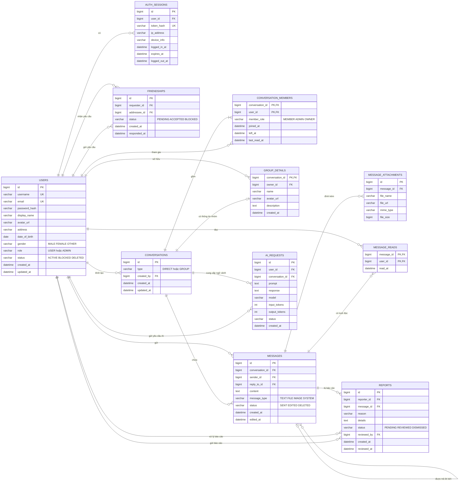

# ERD - Java Chat System

ERD phiên bản 1 mô tả dữ liệu cho các phân hệ: tài khoản, đăng nhập, bạn bè,
chat cá nhân/nhóm, tin nhắn, trợ lý AI và báo cáo vi phạm.

## Sơ đồ trực quan

## Mermaid source

## Quy tắc và ràng buộc chính

- `USERS.username` và `USERS.email` là duy nhất.
- Thông tin người dùng theo đề gồm tên đăng nhập (`username`), họ tên
  (`display_name`), địa chỉ (`address`), ngày sinh (`date_of_birth`), giới tính
  (`gender`) và email.
- Một cặp người dùng chỉ có một bản ghi trong `FRIENDSHIPS`; hai người không
  được trùng nhau trong cùng một quan hệ.
- `CONVERSATIONS.type` phân biệt chat cá nhân (`DIRECT`) và chat nhóm (`GROUP`).
- Hội thoại nhóm có đúng một bản ghi `GROUP_DETAILS`; hội thoại cá nhân không có.
- `CONVERSATION_MEMBERS` là bảng nối người dùng với hội thoại. Khóa chính kép
  ngăn một người tham gia cùng một hội thoại nhiều lần.
- `MESSAGE_READS` dùng khóa chính kép để mỗi người chỉ có một trạng thái đọc cho
  mỗi tin nhắn.
- `MESSAGES.reply_to_id` có thể rỗng và tham chiếu lại `MESSAGES.id`.
- `REPORTS.reviewed_by` có thể rỗng cho tới khi quản trị viên xử lý báo cáo.
- `AI_REQUESTS.conversation_id` có thể rỗng nếu yêu cầu AI không thuộc một cuộc
  trò chuyện cụ thể.

## Giả định của phiên bản 1

- Quản trị viên được biểu diễn bằng `USERS.role`, chưa tách thành bảng riêng.
- Thành viên và vai trò trong nhóm được quản lý chung bằng
  `CONVERSATION_MEMBERS.member_role`.
- File đính kèm được lưu ở hệ thống file/object storage; cơ sở dữ liệu chỉ giữ
  metadata và đường dẫn.
- Xóa người dùng và tin nhắn là xóa mềm thông qua trường `status`.

